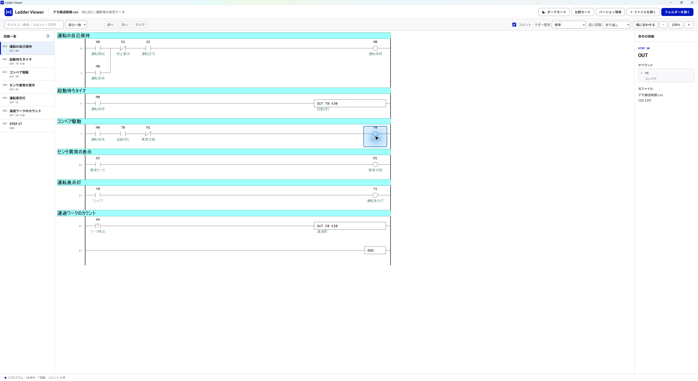
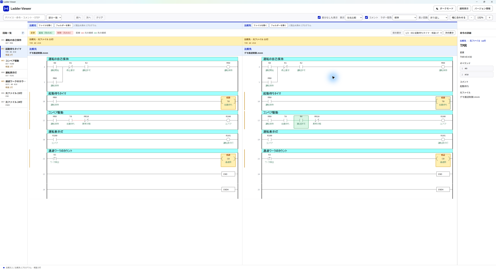

# Ladder Viewer

三菱MELSECのCSVとキーエンスのMNMを、ラダー図として表示・比較するWindowsアプリです。

[ビルド・テスト](docs/BUILD.md) · [変更履歴](CHANGELOG.md) · [TODO](TODO.md)

## 画面例

撮影用に生成した架空の搬送制御プログラムです。画像をクリックすると原寸のPNGを開けます。

MELSECのラダー表示：

KEYENCEのラダー比較：

## 起動

[GitHub Releases](https://github.com/fa-yoshinobu/Ladder_viewer/releases) から `LadderViewer-win-x64.zip` をダウンロードして展開し、中の `LadderViewer.exe` を起動してください。ウィンドウを閉じると終了します。

- [最新版のWindows x64 ZIP](https://github.com/fa-yoshinobu/Ladder_viewer/releases/latest/download/LadderViewer-win-x64.zip)
- [ZIPのSHA-256チェックサム](https://github.com/fa-yoshinobu/Ladder_viewer/releases/latest/download/LadderViewer-win-x64.zip.sha256)

| 実行環境 | 要件 |
| --- | --- |
| OS | Windows 10/11、x64 |
| .NET | .NET 10 Desktop Runtime、x64 |
| 画面表示 | Microsoft Edge WebView2 Runtime |

## 使い方

1. 「ファイルを開く」または「フォルダーを開く」でプログラムを選びます。複数選択やドラッグ＆ドロップにも対応します。
2. 複数のプログラムを開いた場合は、上部の「プログラム」で切り替えます。
3. 左の回路一覧から移動し、「幅に合わせる」や倍率ボタンで表示を調整します。
4. 接点・コイル・命令を選ぶと、右側に詳細を表示します。右クリックの「コピー」で内容をコピーできます。

検索欄（Ctrl+F）でデバイス・命令・コメント・STEPを検索できます。「前へ」「次へ」で結果へ移動します。

同じフォルダーに `comment.csv` を置くと、デバイスコメントを読み込みます。「コメント」で表示を切り替えます。

「ダークモード」「ライトモード」と「ラダー配色」で配色を変更できます。「長い回路」では折り返し／横スクロールを切り替えます。

テーマ・配色・ST色分け・長い回路・コメント表示と、ウィンドウの位置・サイズ・最大化状態は次回起動へ引き継ぎます。長い回路とコメント表示は3画面で共有します。ズームは保存せず、プログラムを開くと幅へ合わせます。保存位置のモニターがなくなった場合は既定位置で開きます。

## 入力形式

| メーカー | プログラム |
| --- | --- |
| MELSEC | 命令リストCSV、照合結果CSV |
| KEYENCE | MNM |

## 比較

「比較モード」を押し、「比較元」と「比較先」でそれぞれファイルまたはフォルダーを開いてください。「前の差分」「次の差分」で変更箇所へ移動できます。「通常表示」で元の表示へ戻ります。

照合結果CSVを開いた場合も、比較元と比較先を左右に表示します。「表示」で左右比較／比較元のみ／比較先のみを選べます。

標準配色では、変更を黄色、比較元のみにある行を緑、比較先のみにある行を赤で表示します。

## 「送る」から開く

「バージョン情報」の［「送る」に追加］で登録すると、エクスプローラーの右クリック→「送る」→「Ladder Viewer」でファイルやフォルダーを開けます。Windows 11では「その他のオプションを確認」内にあります。EXEを移動した場合は再登録してください。

## ライセンス

[MITライセンス](LICENSE)です。本体と使用ライブラリのライセンス全文は、アプリの「バージョン情報」でも確認できます。

## Release maintenance

Local distribution files are created in `artifacts/release/`. Before a new release, update `.github/release-notes.md` Changes from the Unreleased changelog. Published ZIPs are never rebuilt for rescans; use the `Scan release with VirusTotal` workflow and `release_tag`. The `VT_API_KEY` secret is required. VirusTotal submissions are public.

SemVerの互換性は対応する入力形式と設定保存形式を基準にします。製品バージョンは `package.json` の既存値を維持しています。
